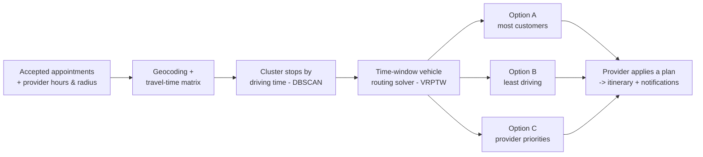
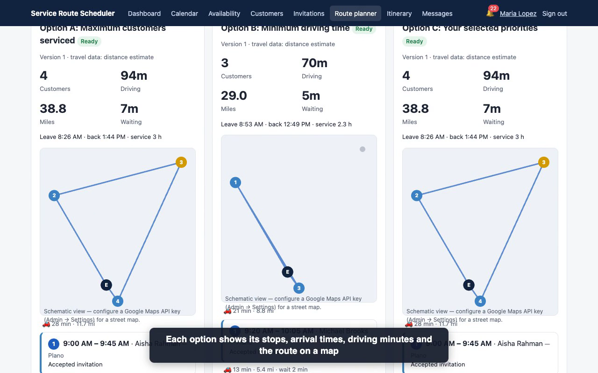

# Service Route Scheduler

**A scheduling and route-planning platform for field-service providers: it turns customer time windows, working hours and driving time into daily routes the provider chooses from, instead of one answer they have to trust.**

---

## The problem & who it's for

Scheduling field-service visits (lawn care, pool service and similar) sounds simple until the real constraints appear: customer time windows, provider working hours, service radius, a cap on visits per day, and the driving time between every stop.

- **Providers** need to publish availability, invite customers, and get a workable route for the day without juggling spreadsheets and maps.
- **Customers** need to see proposed times, accept or decline them, and ask for a different time without phone tag.

## Product decisions & trade-offs

| Decision | Why | Trade-off |
|---|---|---|
| **One account, two roles.** A person can be a provider, a customer, or both, with a Provider/Customer view switch. | Real people wear both hats. Separate accounts would split their calendar and history. | Every screen and permission check has to know which role is active. |
| **Options A/B/C instead of one "optimal" route.** A = most customers served, B = least driving, C = built from the provider's own priorities. | "Optimal" depends on the provider's goal that day. Showing the choice side by side keeps the person in control. | More to compute and more to show on screen; the provider makes one extra decision. |
| **Optimization runs in a background worker.** | Route solving, notification retries, reminders and expirations shouldn't block the user's page. | Results arrive a moment later instead of instantly; needs a scheduled worker. |
| **No-framework stack.** Plain PHP 8, MySQL 8, server-rendered pages, vanilla JS/CSS. The routing solver is written in PHP rather than using Google OR-Tools. | Runs on ordinary PHP hosting with no extra runtime. | More built by hand; a dedicated solver library could be swapped in later. |
| **Works without paid APIs.** | Without a Google Maps key, travel times are estimated from distance, and each route plan says which source it used. | Estimates are less accurate than traffic-aware driving times. |

## Key features

- **Availability & invitations:** recurring provider windows, customer preferred windows and blackouts; invite everyone, a group or one customer, with expiry and conflict rules.
- **Change negotiation:** customers propose a new time, shown as original vs. proposed; version checks prevent conflicting edits.
- **Calendar & itinerary:** day/week/month calendar with role indicators; daily itinerary with navigation links.
- **Notifications:** in-app, email, SMS and browser notifications, reminders, "on the way" alerts, and messaging.
- **Admin & security:** account verification, complaints, suspension, audit logs, time-limited access grants; MFA, role-based access, rate limiting, and encryption of addresses and messages.

## How it works

## Scale

- **29** database tables, **21** application libraries, **38** screens for providers, customers and administrators
- **309** automated checks (workflow scenarios, function coverage, and end-to-end UI tests), all passing
- Load test with 3,000 users, 60 providers, ~9,000 relationships and ~12,000 appointments: slowest page **0.35 s** (target 3 s), appointment update **0.006 s** (target 2 s)
- 19 of 19 pages tested fit a 390 px phone screen

These are test and synthetic-load results, not production usage.

## Screenshots

*Route planner on demo data: Option A serves 4 customers with 94 minutes of driving; Option B serves 3 with 70 minutes. The provider picks the trade-off.*

## What's next

- Background web push, so browser notifications arrive when the app isn't open
- Evaluate a dedicated solver library (e.g., OR-Tools) against the built-in solver
- Pilot with real field-service providers to see which option they actually pick, and why

## About me

**Cheran Seripally** — Product strategy & development | MS ITM @ UT Dallas
[linkedin.com/in/cheran-seripally](https://www.linkedin.com/in/cheran-seripally)

---

© 2026 Cheran Seripally. All rights reserved. Source code is private; available to recruiters on request.
